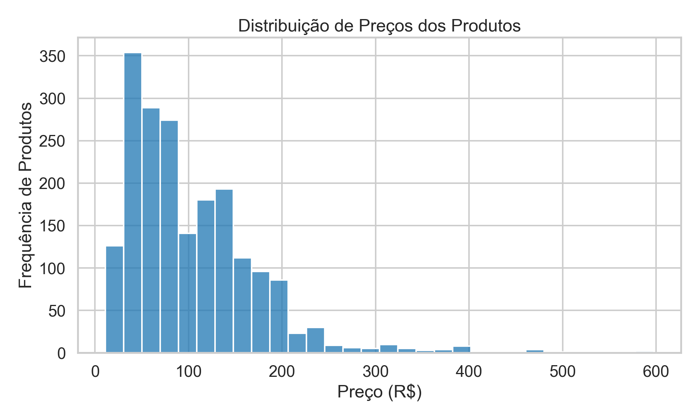
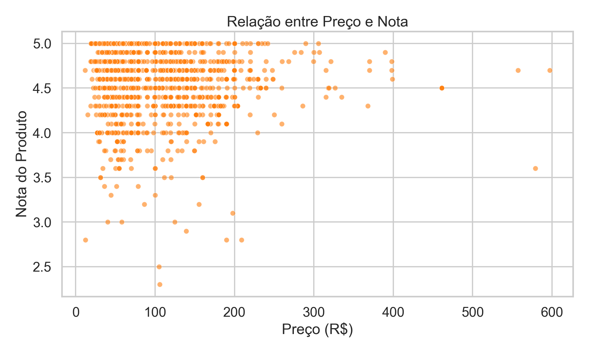
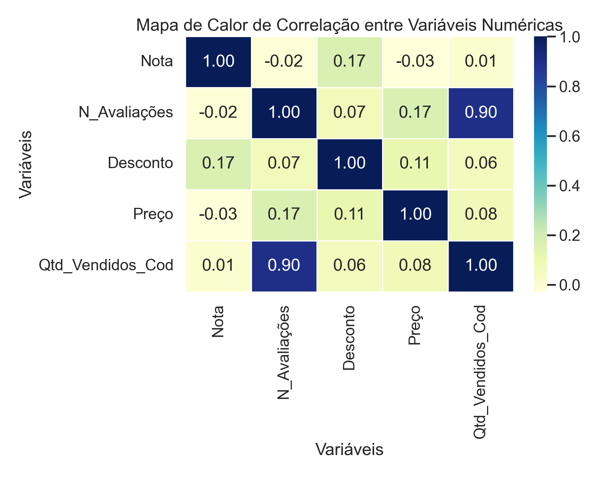
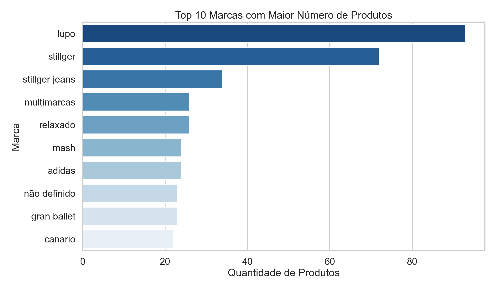
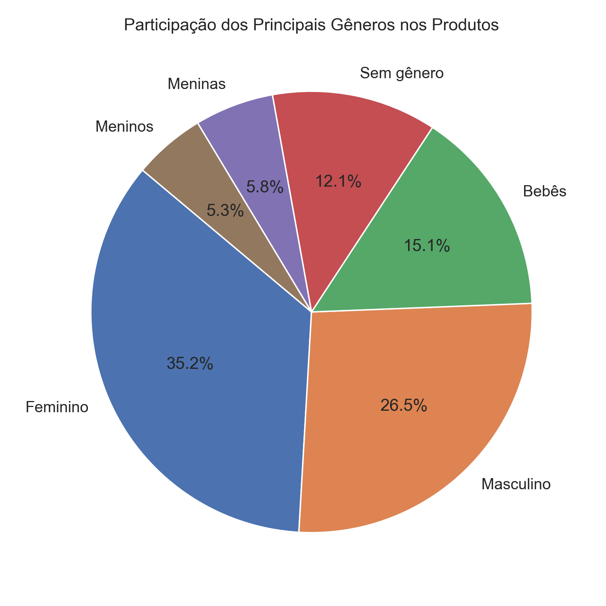
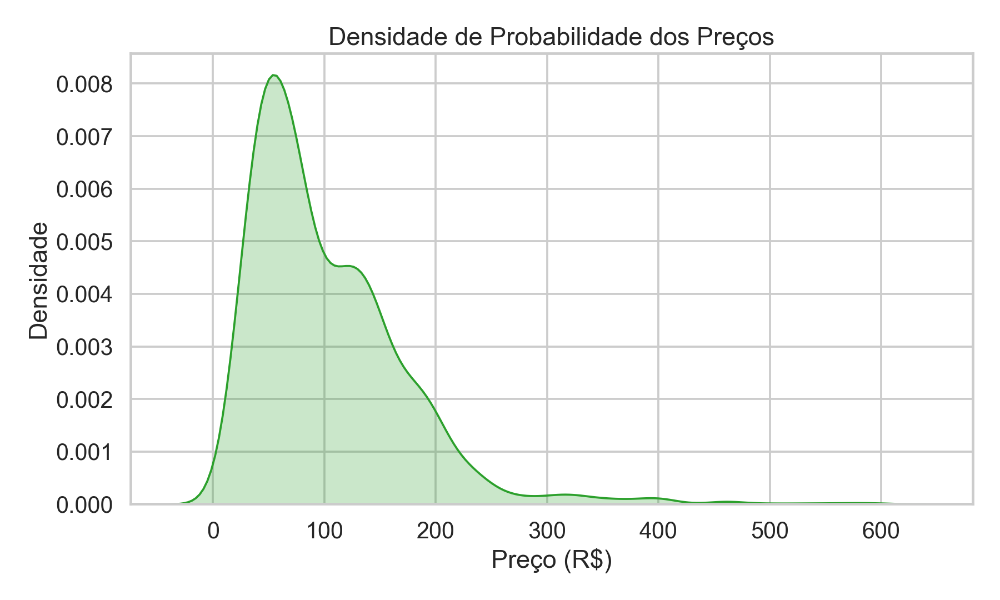
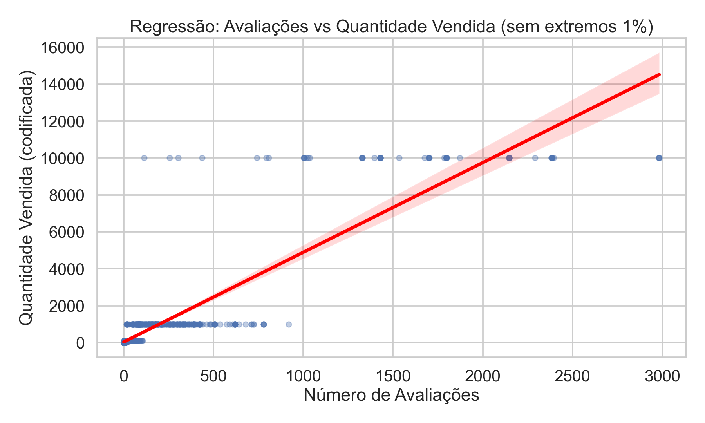

# Estudo de Gráficos: EDA de produtos de e-commerce

Estudo de visualização de dados com **pandas, seaborn e matplotlib**, feito durante o curso **Profissão: Cientista de Dados (EBAC)**.

## Conteúdo

| Arquivo | O que é |
|---|---|
| `codigo de geraçao.py` | Script que lê `ecommerce_preparados.csv` e gera 7 gráficos em `graficos/` |
| `ecommerce_preparados.csv` | Base já tratada com 2.199 produtos de vestuário e 24 colunas: título, nota, nº de avaliações, desconto, marca, material, gênero, temporada, 3 reviews, quantidade vendida, preço, mais as versões normalizadas (MinMax) e codificadas. A origem da coleta não está documentada no repositório |
| `graficos/` | Os 7 PNGs gerados pelo script |
| `profissao_cientista_de_dados_m13_projeto.py` | Exercício do Módulo 13 (exportado do Colab): média, mediana e desvio padrão de preços por categoria, boxplot, barras e treemap com plotly |

## Gráficos gerados

| | |
|---|---|
|  |  |
|  |  |
|  |  |
|  | |

1. Histograma de preços
2. Dispersão preço × nota
3. Mapa de calor de correlação (nota, avaliações, desconto, preço e quantidade vendida)
4. Top 10 marcas por número de produtos
5. Pizza dos principais gêneros
6. Densidade de preços
7. Regressão nº de avaliações × quantidade vendida, sem o 1% de valores extremos

## Como executar

```bash
pip install pandas seaborn matplotlib
python "codigo de geraçao.py"
```

O script do Módulo 13 precisa de outro arquivo, que **não está no repositório**: `MODULO7_PROJETOFINAL_BASE_SUPERMERCADO.csv`, a base de produtos de um supermercado do Chile fornecida pelo curso da EBAC. Para rodá-lo, coloque esse CSV na mesma pasta e instale também o `plotly`:

```bash
pip install plotly
python profissao_cientista_de_dados_m13_projeto.py
```
